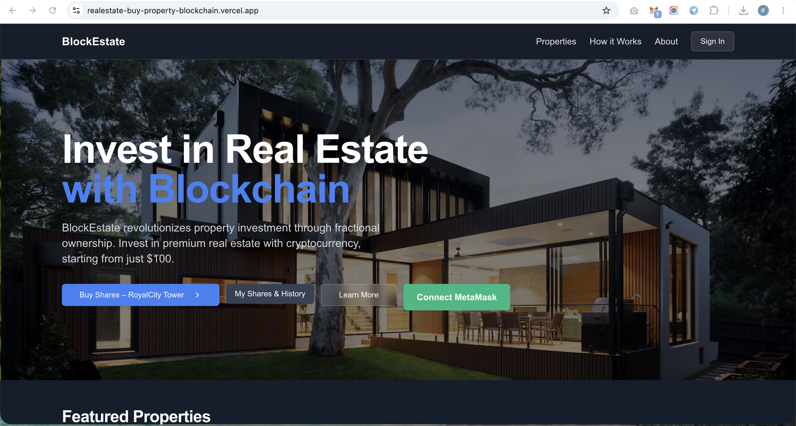
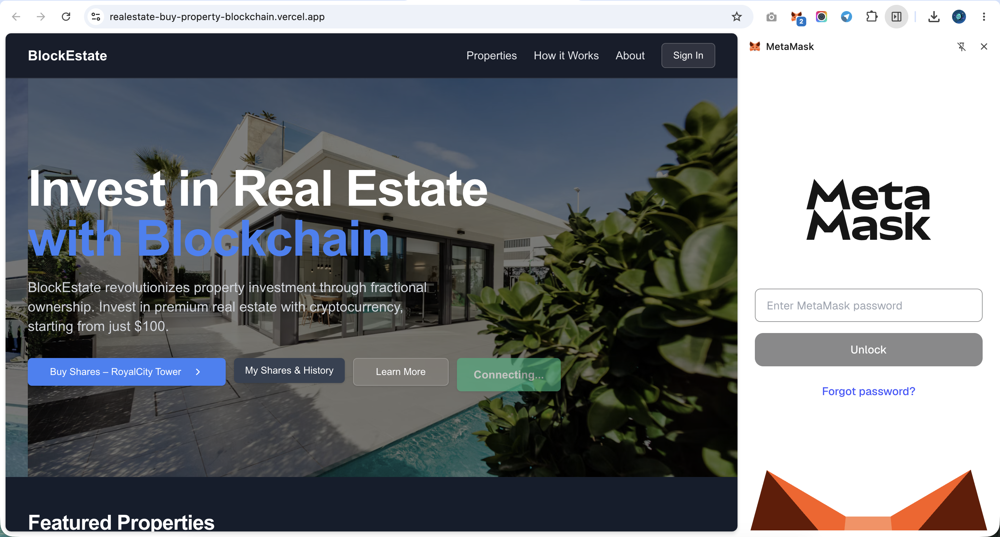
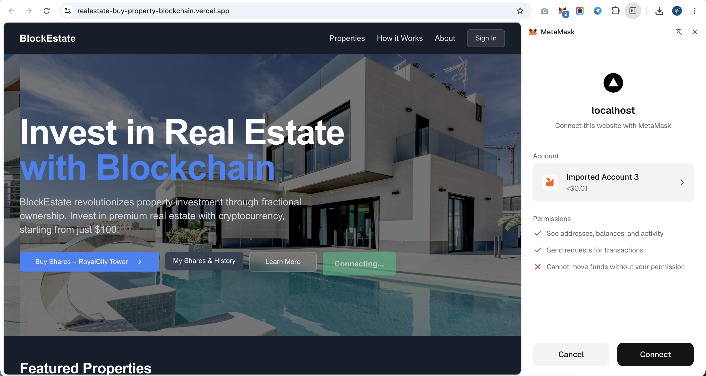
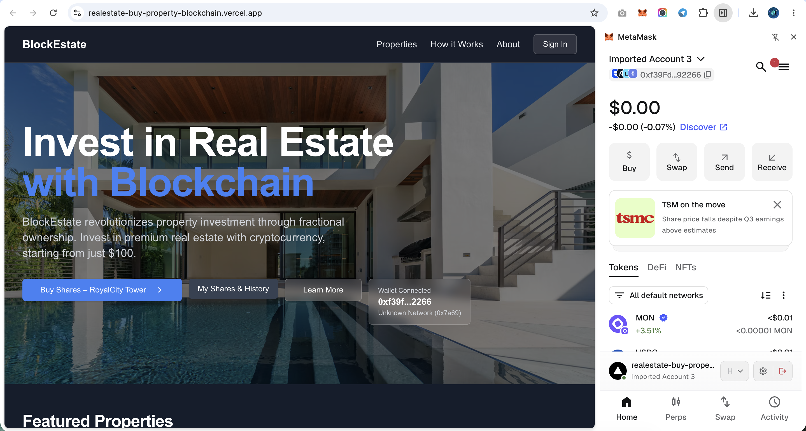
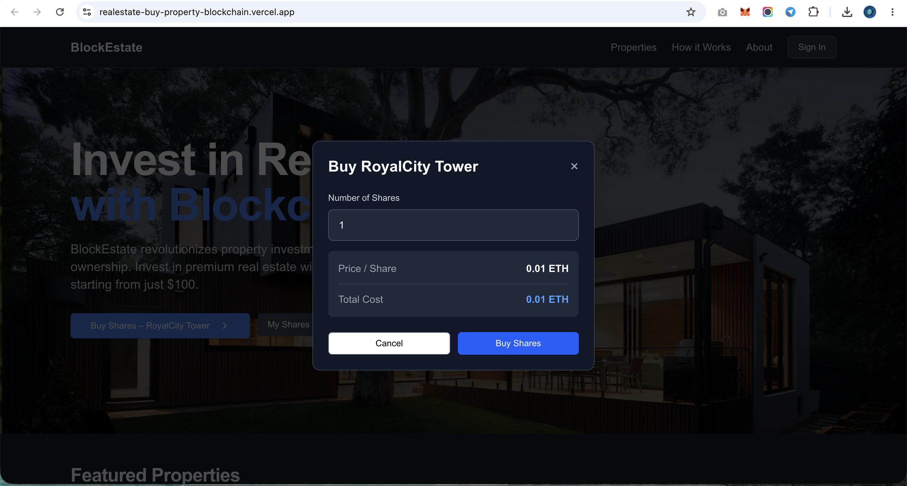
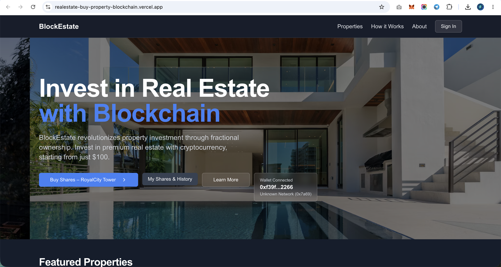
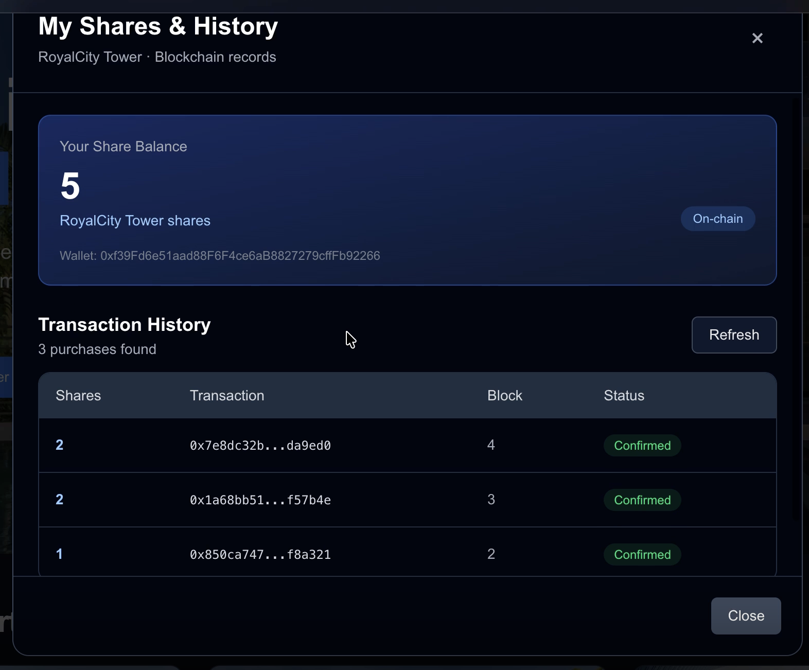

# PropChain — Decentralized Fractional Real Estate Investment DApp

PropChain is a blockchain-based real estate investment demo that explores fractional property share purchases through a decentralized application (DApp). Users can connect a MetaMask wallet, view property share information, and interact with a Solidity smart contract to purchase available shares.

## 🔗 Project Links

- **GitHub Repository:** [realestate-buy-property-blockchain](https://github.com/neeleshwarimehra/realestate-buy-property-blockchain)
- **Vercel Project Dashboard:** [View on Vercel](https://realestate-buy-property-blockchain.vercel.app/)
- **Live Demo:** Add your public Vercel deployment URL here.

> Note: The Vercel dashboard link is for project management. Use the public deployment URL for visitors to access the application.

## 📸 Screenshots

### Screenshot 1 — Home Page



### Screenshot 2 — Application Overview



### Screenshot 3 — Property Listings



### Screenshot 4 — Property Details



### Screenshot 5 — Fractional Share Investment



### Screenshot 6 — Wallet Integration



### Screenshot 7 — Application Interface



*Replace the screenshot headings with more specific descriptions if the images show different screens.*

## ✨ Features

- **MetaMask Integration:** Connect a browser wallet to interact with blockchain functionality.
- **Fractional Share Purchases:** Enter a share quantity and calculate the estimated purchase cost.
- **Smart Contract Integration:** Interact with Solidity smart contracts through ethers.js.
- **Property Information:** Display property and share-related information.
- **Investment Statistics:** View total shares, price per share, shares sold, and shares available.
- **Wallet Share Balance:** Display the connected user's share balance when supported by the deployed contract.
- **Transaction Feedback:** Show transaction submission, confirmation, and error messages.
- **Responsive Web Interface:** Navigate the application on supported desktop and mobile screen sizes.

## 🛠️ Technology Stack

| Technology | Purpose |
|---|---|
| Next.js | Frontend framework and routing |
| React | User interface |
| TypeScript | Type-safe frontend development |
| Solidity | Smart contract development |
| Hardhat | Smart contract development and testing |
| ethers.js | Blockchain and contract interaction |
| MetaMask | Wallet connection and transaction signing |
| Vercel | Frontend deployment and hosting |

## 📁 Application Routes

| Route | Description |
|---|---|
| `/` | Home page |
| `/about` | About the project |
| `/how-it-works` | Application workflow |
| `/properties` | Property listings |
| `/property/[id]` | Individual property details |

## 🚀 Getting Started

### Prerequisites

- Node.js and npm
- Git
- MetaMask browser extension for wallet functionality
- A compatible blockchain network with the required smart contract deployed

### 1. Clone the repository

```bash
git clone https://github.com/neeleshwarimehra/realestate-buy-property-blockchain.git
cd realestate-buy-property-blockchain
```

### 2. Install dependencies

```bash
npm install
```

### 3. Configure the smart contract

Check `lib/realEstateContract.ts` and confirm that the contract address and ABI match the deployed Solidity contract.

Make sure MetaMask is connected to the blockchain network expected by the application.

### 4. Start the development server

```bash
npm run dev
```

Open [http://localhost:3000](http://localhost:3000) in your browser.

### 5. Build for production

```bash
npm run build
```

## ☁️ Deployment on Vercel

The Next.js frontend can be deployed through Vercel.

1. Import the GitHub repository into Vercel.
2. Select **Next.js** as the framework preset.
3. Set the build command to `npm run build`.
4. Keep the default Next.js output directory.
5. Configure any required environment variables in the Vercel project settings.
6. Deploy and test the public application URL.

**Important:** Deploying the frontend does not deploy the Solidity smart contract. The contract must be deployed separately, and the frontend must use the correct contract address, ABI, and blockchain network.

## 🔐 Security Notes

- Never commit private keys, wallet seed phrases, or API secrets.
- Use a test network and test funds during development.
- Review and test smart contracts before using real assets.
- Verify the legal and ownership implications of any real-world property investment independently.

## 📌 Project Status

The Next.js production build completes successfully, including TypeScript checks and page generation.

Blockchain functionality depends on the configured contract, deployed network, and wallet setup. A successful frontend build alone does not verify that on-chain transactions work correctly.

## 📄 License

Add a `LICENSE` file and specify the applicable license before distributing or reusing this project.
